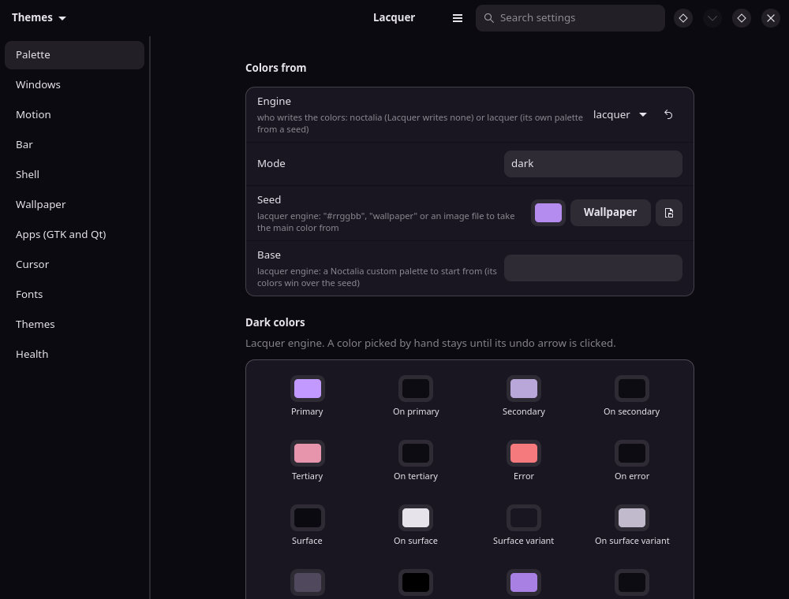

# Lacquer

Desktop look customiser for Hyprland. One tool changes the window look, animations, bar and shell
theme, colour palette, wallpaper, GTK/Qt theme, cursor and fonts, with a live preview that you keep
or revert.



- **Live preview.** Every change shows on the real desktop first. Nothing is saved until you keep it.
- **Keep or revert.** `lacquer keep` saves the preview, `lacquer revert` drops it. A fixed key
  (Super + BackSpace) reverts blind if the screen is unusable.
- **Auto-revert for risky settings.** Settings that can leave you unable to see or click (opacity
  near 0, screen shaders, tiny cursors or fonts, heavy blur) start a 15 s timer and revert unless
  you keep them.
- **Themes.** A whole look is one TOML file made of sections. Save, apply and delete themes; every
  kept look also gets an automatic snapshot you can restore.
- **CLI and window.** The GTK window (`lacquer gui`) is a front-end over the same core as the CLI,
  and every command has `--json` output for scripts.

## Sections

| Section | Changes | Needs |
| --- | --- | --- |
| `windows` | Hyprland look options: gaps, borders, rounding, opacity, blur, shadows | Hyprland |
| `motion` | Hyprland animations and curves | Hyprland |
| `bar`, `shell`, `wallpaper` | Noctalia bar, shell theme and wallpaper | Noctalia |
| `palette` | Colour palette, from Noctalia or Lacquer's own engine | ImageMagick for a palette from an image |
| `toolkit` | GTK and Qt theme, icons | gsettings; qt6ct for Qt |
| `cursor` | Cursor theme and size | |
| `fonts` | Interface fonts | |

A section whose program is not installed hides itself. `lacquer status` lists the usable ones.

## Requirements

- Hyprland with a Lua config (`~/.config/hypr/hyprland.lua`)
- Python 3.11 or newer
- For the window: GTK 4, libadwaita and PyGObject
- Optional: Noctalia, qt6ct, nwg-look, ImageMagick

## Install

```sh
curl -fsSL https://raw.githubusercontent.com/Soulmanyes/lacquer/master/install.sh | sh
```

This copies the latest release to `~/.local/share/lacquer`, links `lacquer` into `~/.local/bin` and
runs `lacquer install`. That adds a launcher entry, adds `require` lines for Lacquer's own files to
`hyprland.lua` (a dated backup is made first, and the file is restored if Hyprland reports config
errors) and binds the revert key. Run it inside a Hyprland session, then `lacquer doctor` to check
the setup.

From a clone, `sh install.sh` installs that copy the same way. To run straight from a clone instead
(for working on the code), use `bin/lacquer install`; that copy updates with `git pull` only.

### Updates

The window checks GitHub once a day and shows a banner when a newer release is out. The menu button
in the header has the version, "Check now" and a switch to install updates automatically (off by
default). From a terminal: `lacquer update` checks, `lacquer update install` installs. An update
replaces the app only; your look in `~/.config/lacquer` stays. The update check is the only
connection Lacquer makes.

### Uninstall

```sh
sh ~/.local/share/lacquer/install.sh --uninstall
```

This removes the app, the launcher entry and the `lacquer` link. Your look stays in
`~/.config/lacquer`. To remove what Lacquer added to your config: delete the
`require("config.lacquer...")` lines (and the comment above each) from `~/.config/hypr/hyprland.lua`,
delete `~/.config/hypr/config/lacquer*.lua`, and with Noctalia remove the `lacquer sync` entry from
its dark/light hook.

## Use

```sh
lacquer gui                                   # open the window
lacquer gui windows.decoration.rounding       # open it at one setting

lacquer schema windows                        # keys with type, range and default
lacquer get windows                           # live values, what is saved, what is a preview
lacquer set windows.decoration.rounding 12    # live preview, nothing saved
lacquer keep                                  # save the preview
lacquer revert                                # drop it

lacquer theme list                            # saved themes
lacquer apply <theme>                         # preview a whole theme
lacquer snapshot list                         # automatic copies of every kept look
lacquer doctor                                # check the setup, list overlaps with other config
```

`lacquer unset KEY` stops keeping a key and hands it back to your other config files.

## Other tools that edit the same config

Lacquer writes its own files (`lacquer*.lua` under `~/.config/hypr/config/`) and never edits yours.
A setting has one writer: `lacquer owned` prints what Lacquer claims, so another tool can leave
those alone, and `lacquer adopt KEY...` takes a key over at its live value. `lacquer doctor` warns
when a later config file sets the same option and wins.

hypr-dashboard uses this: it shows the options Lacquer owns as read-only, with a button that opens
Lacquer at that setting.

## License

[CC0 1.0](LICENSE): no rights reserved. The Hyprland socket code in `lacquer/hypr.py` and the
animation style list come from hypr-dashboard (same author, CC0). No themes, icons or cursors are
bundled; Lacquer only reads what is installed.
